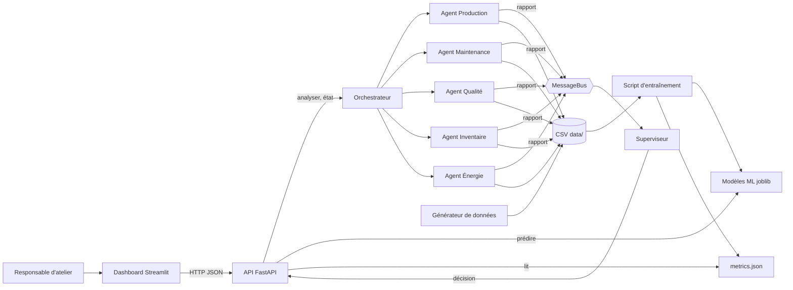
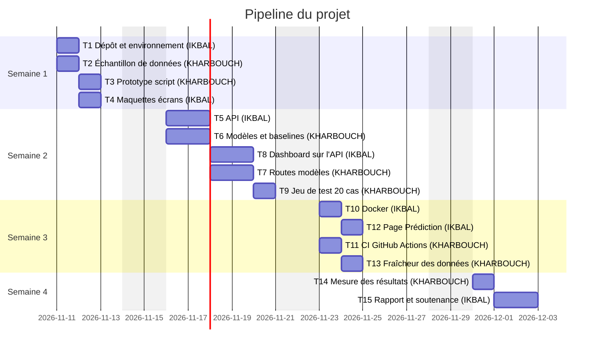

# Dossier de lancement (semaine 1)

Nov 9, 2026 · @Larhlimi · Binôme : Yasser IKBAL / Yasser KHARBOUCH

## Mode d'emploi

La semaine 1 est décisive : sur un projet de 4 semaines, un cadrage flou ou des données indisponibles ne se rattrapent pas. Ce dossier permet à l'enseignant de valider, faire reprendre ou refuser le projet sous 48 heures.

Le dossier comporte quatre livrables. **L'équipe se les répartit : chaque membre rédige seul le ou les livrables dont il est responsable, puis un autre membre le relit.** Le nom du rédacteur et du relecteur figure en tête de chaque livrable ; c'est une preuve de contribution pour la note individuelle.

**Répartition selon la taille de l'équipe**

| Taille | Membre A | Membre B | Membre C | Membre D |
| --- | --- | --- | --- | --- |
| 2 étudiants | 1. Descriptif + 3. Maquette | 2. Dataset + 4. Pipeline |  |  |
| 3 étudiants | 1. Descriptif + 4. Pipeline (consolidation) | 2. Dataset | 3. Maquette |  |
| 4 étudiants | 1. Descriptif | 2. Dataset | 3. Maquette | 4. Pipeline (consolidation) |

Le pipeline des tâches (livrable 4) est consolidé par un seul membre, mais **chaque membre y ajoute lui-même ses propres tâches**.

**Notre répartition**

| Livrable | Rédacteur | Relecteur | Fichier dans le dépôt |
| --- | --- | --- | --- |
| 1. Descriptif du projet | Yasser IKBAL | Yasser KHARBOUCH | `docs/semaine1/1-descriptif.md` |
| 2. Dataset | Yasser KHARBOUCH | Yasser IKBAL | `docs/semaine1/2-dataset.md` + `data/sample/` |
| 3. Maquette globale | Yasser IKBAL | Yasser KHARBOUCH | `docs/semaine1/3-maquette.md` + `docs/semaine1/img/` |
| 4. Pipeline des tâches | Yasser KHARBOUCH | Yasser IKBAL | `docs/semaine1/4-pipeline.md` |

**Circuit GitHub**

1. Le coordinateur crée le dossier `docs/semaine1/` avec un `README.md` qui reprend le tableau « Notre répartition ».
2. Chaque rédacteur copie la section de son livrable dans le fichier indiqué, travaille sur sa propre branche (`semaine1/dataset`, par exemple) et ouvre une pull request.
3. Le relecteur vérifie les critères d'acceptation du livrable, commente dans la pull request, puis l'approuve.
4. Une pull request n'est fusionnée qu'après approbation. Les quatre livrables sont fusionnés sur la branche principale avant la date limite.
5. Le coordinateur pose l'étiquette `semaine1-remis` sur le dernier commit et en informe l'enseignant.

Le coordinateur est Yasser IKBAL. Dans ce dossier, le rédacteur et le relecteur de chaque livrable sont deux personnes distinctes.

## Livrable 1 : descriptif du projet

Rédacteur : Yasser IKBAL   Relecteur : Yasser KHARBOUCH   Fichier : `docs/semaine1/1-descriptif.md`

**1.1 Contexte et problème.** Dans une usine, la production, la maintenance, la qualité, les stocks et l'énergie sont suivis chacun de leur côté, avec leurs propres tableaux et leurs propres seuils. Les responsables (chef d'atelier, responsable maintenance) doivent recouper ces vues à la main pour décider s'il faut intervenir ou arrêter une machine, ce qui est lent et laisse passer des signaux croisés (une machine qui chauffe et dont la qualité baisse). Notre système remplace ce recoupement manuel par six agents spécialisés et un superviseur qui produit une décision unique et justifiée.

**1.2 Objectif.** Fournir en une seule requête (moins d'une seconde sur le jeu de données du projet) l'état de l'usine, une décision du superviseur parmi six niveaux et des prédictions ML (anomalie machine, prochain ordre, prochain lot, consommation d'énergie).

**1.3 Utilisateurs cibles et scénario d'usage principal.** Utilisateurs : le responsable d'atelier et le responsable maintenance.
1. L'utilisateur ouvre le tableau de bord Streamlit.
2. Il lit la santé de l'usine (sur 100), l'état des six agents et la décision du superviseur.
3. Il ouvre « Alertes & Décisions » pour voir quelle machine pose problème et pourquoi.
4. Il ouvre « Prédiction Interactive », règle température, pression, vibration et vitesse, et obtient un verdict d'anomalie avec les seuils dépassés et l'action conseillée.
5. Il consulte « Analyse Approfondie » pour voir les tendances (taux de réalisation, statuts).

**1.4 Fonctionnalités du MVP** (binôme : 3 fonctionnalités)

| N° | Fonctionnalité | Ce que l'utilisateur voit ou obtient | Priorité |
| --- | --- | --- | --- |
| F1 | Analyse multi-agents et décision du superviseur | Statut de chaque agent (OK, ALERTE, CRITIQUE, DONNEES_MANQUANTES) et une décision parmi FONCTIONNEMENT_NORMAL, ACTION_PLANIFIEE, SURVEILLANCE_RENFORCEE, INTERVENTION_IMMEDIATE, ARRET_D_URGENCE, DONNEES_INSUFFISANTES | Indispensable |
| F2 | Prédictions ML servies par l'API | Verdict d'anomalie avec score, prédiction du prochain ordre et du prochain lot, consommation attendue ; métriques d'évaluation consultables | Indispensable |
| F3 | Tableau de bord Streamlit | Pages Dashboard, Alertes & Décisions, Prédiction interactive, Analyse approfondie, qui n'appellent que l'API | Indispensable |

**1.5 Services et composants techniques**

| Service ou composant | Rôle dans le projet | Technologie choisie | Pourquoi ce choix |
| --- | --- | --- | --- |
| Modèle (LLM ou ML) | Détecter les anomalies, prédire le statut du prochain ordre et du prochain lot, prédire la consommation | scikit-learn : IsolationForest, RandomForest, GradientBoosting, LinearRegression | Données tabulaires de petite taille ; modèles rapides, explicables et évaluables avec des baselines. Aucun LLM : les décisions du superviseur sont des règles déterministes testables |
| Recherche ou mémoire (RAG, base vectorielle, SGBD) | Historique des machines, production, qualité, stocks, énergie, événements | Fichiers CSV dans `data/` (pandas) | Volume faible, aucune installation, échantillon versionnable ; un SGBD serait un surcoût pour 4 semaines |
| Outils appelés par l'agent | Échange entre agents et lecture des données | MessageBus interne (thread-safe), pandas | Les agents ne se parlent que par messages, ce qui rend chaque agent testable isolément |
| API | Point d'entrée unique : état, analyse, agents, alertes, décisions, prédictions, métriques | FastAPI | Typage Pydantic, documentation OpenAPI automatique, tests avec TestClient. L'API ne fait jamais d'entraînement |
| Interface | Tableau de bord à 7 pages | Streamlit | Interface rapide à produire en Python, sans le `.joblib` : tout passe par l'API |
| Conteneur et intégration continue | Reproductibilité et contrôle qualité | Docker, GitHub Actions | CI existante : ruff, mypy, pytest avec seuils de couverture. **Docker : à écrire (tâche T10)** |

**1.6 Hors périmètre.**
- Connexion à de vraies machines ou à des capteurs industriels (les données sont simulées).
- Authentification et gestion des droits.
- Base de données relationnelle et flux temps réel (Kafka, MQTT).
- Apprentissage en ligne : l'entraînement reste un script hors API.
- Déploiement sur un serveur public.
- Lecture des données par rapport à la dernière date présente dans le fichier : les agents lisent les dernières 24 h ou 7 jours par rapport à l'heure courante, donc les données doivent être régénérées (`usine generer-donnees`) pour être « fraîches » (limite connue, tâche T13 si le temps le permet).

**1.7 Écart avec la fiche du catalogue.** À confirmer : la fiche du catalogue n'a pas été fournie au rédacteur lors de la rédaction. Une fois la fiche en main, remplacer cette ligne par la liste des ajouts, retraits et modifications, ou par « aucun ».

**Critères d'acceptation (vérifiés par le relecteur)**

- [ ] Le problème et l'utilisateur sont compréhensibles sans le catalogue.
- [ ] Le nombre de fonctionnalités correspond à la taille de l'équipe.
- [ ] Chaque fonctionnalité est démontrable (pas de formulation vague comme « améliorer »).
- [ ] Chaque composant technique a une justification d'une ligne.
- [ ] Le hors périmètre est rempli.

## Livrable 2 : dataset

Rédacteur : Yasser KHARBOUCH   Relecteur : Yasser IKBAL   Fichiers : `docs/semaine1/2-dataset.md` + `data/sample/`

**2.1 Description**

| Rubrique | Réponse |
| --- | --- |
| Nom et source (lien) | Données simulées de l'usine, générées par `scripts/generate_data.py` (commande `usine generer-donnees`) ; générateur dans le dépôt du projet |
| Producteur ou propriétaire | L'équipe (Yasser IKBAL, Yasser KHARBOUCH) : données créées par nous, sans propriétaire externe |
| Volume (nombre de fichiers, lignes, pages, taille) | 6 fichiers CSV. Échantillon dans `data/sample/` : machines 100 lignes, énergie 100, production 90, qualité 90, stocks 100, événements 60, soit 56 Ko. Jeu complet : environ 30 jours de données, quelques centaines de Ko, régénérable à volonté |
| Format et structure | CSV UTF-8. `machines` : timestamp, machine_id, temperature, vibration, pression, rpm, etat, anomalie. `production` : date, machine_id, produit, objectif, produit_reel, taux_realisation, retard, statut. `quality` : date, machine_id, produit, lot_taille, conformes, defauts, taux_conformite, type_defaut, statut. `energy` : timestamp, machine_id, conso_kwh, puissance_kw, cout_eur, anomalie_conso, statut. `inventory` : date, matiere, stock_actuel, stock_min, stock_max, consommation_jour, jours_restants, statut. `events` : timestamp, type, machine_id, agent, severite, description, action_prise, resolu |
| Langue et période couverte | Libellés en français ; l'échantillon couvre du 9 octobre au 7 novembre 2026 (stocks : jusqu'au 28 octobre) ; cinq machines M001 à M005 |
| Licence et droits d'usage | Données créées par l'équipe, utilisables librement dans le projet et sa soutenance. Aucune donnée tierce dans la source principale |
| Données personnelles ou sensibles, et traitement prévu | Aucune : données entièrement simulées, aucun nom, aucun identifiant de personne |
| Emplacement des données complètes | Non versionnées : générées dans `data/` par `usine generer-donnees` (ou dans le dossier indiqué par la variable `USINE_DATA_DIR`) ; `data/` est dans `.gitignore`, seul `data/sample/` est dans Git |

**2.2 Qualité constatée sur l'échantillon.**
- Valeurs manquantes : aucune ; doublons : aucun (vérifié avec pandas sur les 6 fichiers).
- Déséquilibre : dans `machines.csv`, 1 ligne sur 100 est une anomalie (1 %) ; production 67 % OK, 22 % RETARD, 11 % CRITIQUE ; qualité 86 % OK, 11 % ALERTE, 3 % CRITIQUE. Les classes rares expliquent les scores modestes des modèles, d'où l'usage de baselines et de la métrique F1 plutôt que de l'exactitude.
- Limite principale : les données sont simulées. Elles prouvent que le pipeline fonctionne mais pas que les modèles se généralisent à une vraie usine. Les valeurs sont toutes plausibles par construction, sans bruit réel de capteur.
- Fraîcheur : les agents lisent les dernières 24 h (maintenance, énergie) ou 7 jours (production, qualité). Des données anciennes donnent le statut DONNEES_MANQUANTES, et le superviseur répond alors DONNEES_INSUFFISANTES au lieu de « normal ».

**2.3 Justification**

| Fonctionnalité | Données utilisées | En quoi elles suffisent |
| --- | --- | --- |
| F1 Analyse multi-agents | `machines`, `production`, `quality`, `inventory`, `energy` | Chaque agent lit son fichier et compare à ses seuils (température 85/92 °C, vibration 3/4, pression 7/8 bar, conformité 0,95/0,85...) ; les cinq fichiers couvrent les cinq agents |
| F2 Prédictions ML | `machines` (anomalies), `production` et `quality` (historique par machine, statut suivant), `energy` (machine, heure) | Environ 30 jours par machine donnent assez de lignes pour entraîner et évaluer sur 20 % de données jamais vues, avec baselines |
| F3 Tableau de bord | Réponses de l'API construites sur ces mêmes fichiers, plus `events` | Les pages affichent états, alertes, historiques et tendances ; l'interface ne lit aucun fichier directement |

**2.4 Alternative de repli.** Si le générateur devient inutilisable, repli sur le jeu public **AI4I 2020 Predictive Maintenance Dataset** (UCI Machine Learning Repository, 10 000 lignes, température, vitesse, couple, usure d'outil, panne), licence CC BY 4.0, lien vérifié : https://archive.ics.uci.edu/dataset/601. Ce jeu est lui-même synthétique. Ce que nous perdons : il n'a ni production, ni qualité, ni stocks, ni énergie, donc seuls l'agent de maintenance et le modèle d'anomalie seraient alimentés ; les autres agents resteraient en DONNEES_MANQUANTES (le superviseur le signalerait explicitement).

**2.5 Jeu de test.** 20 scénarios dans `data/sample/test_scenarios.csv` : pour chaque combinaison de statuts des cinq agents (OK, ALERTE, CRITIQUE, DONNEES_MANQUANTES), la décision attendue du superviseur. Répartition : 1 normal, 5 alertes isolées, 3 cas à 2 alertes ou plus, 5 cas à 1 critique, 3 cas à 2 critiques ou plus, 3 cas de données manquantes. Les décisions attendues sont écrites à la main par l'équipe à partir de la règle (2 critiques ou plus : arrêt d'urgence ; 1 critique : intervention ; 2 alertes ou plus : surveillance ; 1 alerte : action planifiée ; sinon données manquantes : insuffisantes ; sinon normal). Le script `data/sample/verifier_scenarios.py` les rejoue sur le vrai superviseur : **20 sur 20 conformes**. Pour la qualité des modèles ML : évaluation sur 20 % de données jamais vues avec baseline naïve (actuellement production F1 0,567 contre 0,265, qualité F1 0,619 contre 0,308, énergie MAE 1,658 contre 2,077 pour la baseline, anomalies précision 0,47 et rappel 0,94).

**Critères d'acceptation (vérifiés par le relecteur)**

- [ ] L'échantillon est dans `data/sample/` et s'ouvre sans erreur.
- [ ] La licence autorise l'usage dans un projet de cours.
- [ ] Les données personnelles éventuelles sont anonymisées ou remplacées par des données fictives.
- [ ] Chaque fonctionnalité du MVP est couverte par la justification.
- [ ] L'alternative de repli est réellement accessible (lien vérifié).
- [ ] Le jeu de test est défini, même partiellement rédigé.

## Livrable 3 : maquette globale

Rédacteur : Yasser IKBAL   Relecteur : Yasser KHARBOUCH   Fichiers : `docs/semaine1/3-maquette.md` + `docs/semaine1/img/`

**3.1 Schéma d'architecture.** Parcours d'une requête : l'utilisateur ouvre une page Streamlit, qui appelle l'API ; l'API interroge l'orchestrateur et les agents (F1) ou le modèle ML chargé en mémoire (F2) ; les agents lisent les CSV et se parlent par le MessageBus ; le superviseur renvoie une décision, et la réponse remonte à l'écran.

**3.2 Légende du schéma**

| Composant | Rôle | Fonctionnalité |
| --- | --- | --- |
| Dashboard Streamlit | Affiche états, alertes, prédictions, tendances ; n'appelle que l'API | F3 |
| API FastAPI | Point d'entrée unique ; ne fait jamais d'entraînement | F1, F2, F3 |
| Orchestrateur | Lance le cycle d'analyse des agents (cycle de 10 s) et le superviseur (5 s) | F1 |
| Agents Production, Maintenance, Qualité, Inventaire, Énergie | Chacun lit ses données, compare aux seuils, publie un rapport | F1 |
| MessageBus | Canal de messages thread-safe entre agents et superviseur | F1 |
| Superviseur | Rassemble les rapports, détecte les conflits, rend la décision parmi six niveaux | F1 |
| CSV `data/` | Données simulées de l'usine | F1, F2 |
| Modèles ML (joblib) | Anomalie, prochain ordre, prochain lot, énergie ; chargés par l'API, non versionnés | F2 |
| Script d'entraînement et `metrics.json` | Entraîne hors API ; `metrics.json` (versionné) garde les performances mesurées | F2 |
| Générateur de données | Produit les CSV simulés (`usine generer-donnees`) | F1, F2 |

**3.3 Maquette des écrans.** Les images sont des captures de l'application actuelle (prototype fonctionnel), avec des données simulées ; l'image du logo dans la barre latérale ne s'affiche pas car il est chargé depuis un site externe, sans conséquence fonctionnelle.

| Écran | Image | Fonctionnalités affichées | Action principale de l'utilisateur |
| --- | --- | --- | --- |
| Dashboard général |  | F1 : santé de l'usine, état des six agents, décision du superviseur, indicateurs, dernières alertes | Lire la décision et repérer l'agent en alerte |
| Alertes & Décisions |  | F1 : historique des alertes et des décisions du superviseur | Identifier la machine et la cause d'une alerte |
| Prédiction interactive |  | F2, F3 : onglets Anomalie, Prochain ordre, Prochain lot, Énergie ; verdict, score, seuils dépassés, action conseillée | Régler les capteurs (ou charger « Panne imminente ») puis analyser |
| Analyse approfondie |  | F3 : taux de réalisation par machine, répartition des statuts, onglets Machines, Énergie, Stocks | Comparer les machines dans le temps |

**3.4 Parcours utilisateur.** Dashboard général (lit la décision du superviseur) → Alertes & Décisions (trouve la machine concernée, par exemple M003) → Prédiction interactive (reproduit les mesures de M003, obtient « anomalie détectée » avec les seuils dépassés et l'action « arrêt machine, inspection immédiate ») → Analyse approfondie (vérifie la tendance de la machine sur le mois).

**Critères d'acceptation (vérifiés par le relecteur)**

- [ ] Chaque composant du livrable 1 apparaît dans le schéma, et inversement.
- [ ] Le parcours d'une requête se suit de bout en bout sur le schéma.
- [ ] Chaque fonctionnalité du MVP est visible sur au moins un écran.
- [ ] Le schéma s'affiche correctement sur GitHub (Mermaid valide ou image présente).
- [ ] Pour une équipe de 4 : les agents ou sous-systèmes et leurs échanges sont représentés. (Sans objet : binôme.)

## Livrable 4 : pipeline des tâches prévues

Consolidateur : Yasser KHARBOUCH   Relecteur : Yasser IKBAL   Fichier : `docs/semaine1/4-pipeline.md`

Point de départ : un prototype existe déjà (agents, API, interface, modèles). Les quatre semaines servent à le fiabiliser, à le conteneuriser, à le mesurer et à le présenter. Les dates sont celles de la semaine 1 (9 novembre 2026) et de la soutenance en semaine 4 ; elles se décalent si le calendrier officiel diffère.

**4.1 Liste des tâches**

| ID | Tâche | Fonctionnalité | Responsable | Dépend de | Semaine | Terminée quand ? (critère vérifiable) |
| --- | --- | --- | --- | --- | --- | --- |
| T1 | Dépôt GitHub, branches, environnement, issues des tâches | F1 F2 F3 | Yasser IKBAL | aucune | 1 | `pip install -e .` et `usine --help` fonctionnent sur les deux machines ; 15 issues créées |
| T2 | Échantillon de données et génération reproductible | F1 F2 | Yasser KHARBOUCH | aucune | 1 | `data/sample/` contient 6 CSV (moins de 10 Mo) et `usine generer-donnees` recrée le jeu complet |
| T3 | Prototype en script : 5 agents et superviseur sur l'échantillon | F1 | Yasser KHARBOUCH | T2 | 1 | `usine analyser` affiche une décision et sort avec le code 1 quand il n'y a pas de données |
| T4 | Maquettes et captures des 4 écrans | F3 | Yasser IKBAL | T1 | 1 | 4 images dans `docs/semaine1/img/` affichées sur GitHub |
| T5 | API : état, analyse, agents, alertes, décisions, schémas Pydantic | F1 | Yasser IKBAL | T3 | 2 | `pytest tests/test_api.py` vert et `/docs` liste toutes les routes |
| T6 | Entraînement des modèles avec baselines et `metrics.json` | F2 | Yasser KHARBOUCH | T2 | 2 | `metrics.json` contient pour chaque modèle F1 ou MAE sur 20 % de données non vues et la baseline |
| T7 | Routes `/modeles/*` servies par l'API (404 propre si modèle absent) | F2 | Yasser KHARBOUCH | T5, T6 | 2 | `pytest tests/test_modeles_api.py` vert |
| T8 | Dashboard Streamlit branché sur l'API (3 pages) | F3 | Yasser IKBAL | T5 | 2 | Aucun import de `joblib` dans `ui/` ; test AppTest vert |
| T9 | Jeu de test de 20 scénarios du superviseur | F1 | Yasser KHARBOUCH | T3 | 2 | `data/sample/verifier_scenarios.py` affiche 20/20 conformes |
| T10 | Dockerfile et docker-compose (API et interface) | F1 F3 | Yasser IKBAL | T5, T8 | 3 | `docker compose up` : `/health` répond 200 et le dashboard s'ouvre |
| T11 | CI GitHub Actions : ruff, mypy, pytest, couverture | F1 F2 F3 | Yasser KHARBOUCH | T7 | 3 | Dernier workflow au vert sur la branche principale |
| T12 | Page Prédiction interactive (4 onglets) | F2 F3 | Yasser IKBAL | T7, T8 | 3 | Les 4 onglets renvoient un résultat depuis l'API (test AppTest) |
| T13 | Lecture des données relative à la dernière date du fichier (fraîcheur) | F1 | Yasser KHARBOUCH | T3 | 3 | Un jeu de données vieux de 60 jours ne donne plus DONNEES_MANQUANTES (test dédié) |
| T14 | Mesure des résultats : journal, métriques, temps de réponse | F1 F2 | Yasser KHARBOUCH | T9, T12 | 4 | `docs/journal.md` complété avec des valeurs mesurées |
| T15 | Rapport et diaporama de soutenance, répétition | F1 F2 F3 | Yasser IKBAL | T14 | 4 | Rapport remis, démonstration de 5 minutes jouée sans erreur |

*T13 est la seule tâche pouvant être abandonnée sans toucher au MVP.*

**4.2 Jalons hebdomadaires**

| Semaine | Jalon démontrable | Tâches qui y mènent |
| --- | --- | --- |
| 1 | Dossier de lancement fusionné, prototype en script | T1, T2, T3, T4 |
| 2 | Agent exposé par l'API, premiers tests | T5, T6, T7, T8, T9 |
| 3 | MVP complet, Docker et CI au vert | T10, T11, T12, T13 |
| 4 | Résultats mesurés, code gelé, soutenance | T14, T15 |

**4.3 Vue chronologique**

**4.4 Chemin critique et charge**

- Chaîne de tâches dont le moindre retard décale la soutenance : T2, T3, T5, T8, T10, T12, T14, T15. Le MVP est complet le 24 novembre (milieu de semaine 3), ce qui laisse 3 jours de marge avant la fin de semaine 3 et la semaine 4 pour absorber un retard.
- Charge par membre (jours de tâches) : Yasser IKBAL 10 jours (T1 1, T4 1, T5 2, T8 2, T10 1, T12 1, T15 2) ; Yasser KHARBOUCH 10 jours (T2 1, T3 1, T6 2, T7 2, T9 1, T11 1, T13 1, T14 1). Écart : 0 jour.

**Critères d'acceptation (vérifiés par le relecteur)**

- [ ] Aucune tâche ne dépasse 2 jours.
- [ ] Chaque fonctionnalité du MVP a au moins une tâche, et chaque tâche a un critère de fin vérifiable.
- [ ] Le MVP est complet au plus tard en fin de semaine 3.
- [ ] Chaque membre a saisi ses propres tâches ; l'écart de charge entre membres reste inférieur à 2 jours.
- [ ] Les tâches existent comme issues GitHub.

## Remise et décision de l'enseignant

**Checklist de remise (coordinateur)**

- [ ] `docs/semaine1/README.md` avec la répartition rédacteurs et relecteurs
- [ ] Les quatre livrables fusionnés sur la branche principale, chacun par une pull request approuvée par son relecteur
- [ ] Échantillon de données dans `data/sample/`
- [ ] Schéma et écrans visibles sur GitHub
- [ ] Issues GitHub créées pour les tâches du pipeline
- [ ] Étiquette `semaine1-remis` posée et enseignant prévenu

**Décision de l'enseignant (sous 48 heures)**

Un seul critère bloquant suffit pour que le dossier soit à reprendre ; un dossier à reprendre est corrigé et remis sous 48 heures.

| Critère | Type | Respecté | Commentaire |
| --- | --- | --- | --- |
| Données accessibles et échantillon présent (L2) | Bloquant | ☐ |  |
| MVP réaliste en 4 semaines pour cette taille d'équipe (L1, L4) | Bloquant | ☐ |  |
| Livrables répartis, chacun avec un rédacteur et un relecteur distincts | Bloquant | ☐ |  |
| Licence et données personnelles traitées (L2) | Bloquant | ☐ |  |
| Architecture cohérente avec les fonctionnalités (L1, L3) | À améliorer | ☐ |  |
| Écrans couvrant tout le MVP (L3) | À améliorer | ☐ |  |
| Tâches courtes, critères de fin vérifiables, charge équilibrée (L4) | À améliorer | ☐ |  |
| Alternative de repli et jeu de test définis (L2) | À améliorer | ☐ |  |

**Décision** : ☐ Validé   ☐ À reprendre   ☐ Refusé (changement de sujet)

Date et visa : \_\_\_\_\_\_\_\_\_\_\_\_\_\_\_\_\_\_\_\_

**Lien avec l'évaluation.** Ce dossier sert de référence pour le critère P1 (respect du cadrage) et alimente P3 (jeu de test et indicateurs) et P7 (pipeline et suivi). La répartition et les pull requests de chaque membre comptent comme preuves pour le coefficient individuel.
