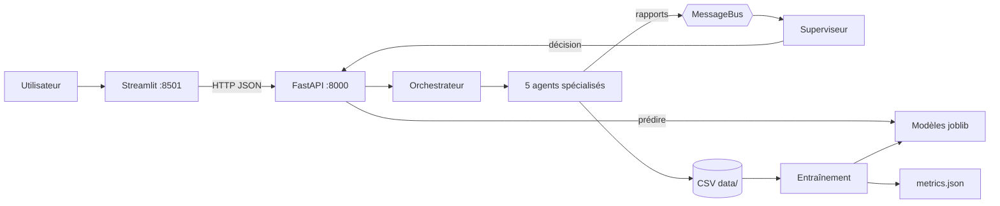

# 🏭 Usine Autonome : système multi-agents de pilotage


Six agents spécialisés (production, maintenance, qualité, inventaire, énergie) et un **superviseur** surveillent une usine simulée, échangent par un bus de messages et produisent une **décision unique et justifiée**. Les prédictions ML (anomalie machine, prochain ordre, prochain lot, consommation) sont servies par une API FastAPI et affichées dans un tableau de bord Streamlit.

**Binôme :** Yasser IKBAL · Yasser KHARBOUCH — EMSI Casablanca, 4IIR.

> ⚠️ Les données sont **simulées** (`usine generer-donnees`). Le projet démontre l'architecture et le pipeline, pas la performance sur une vraie usine.


## Fonctionnalités

| | Fonctionnalité | Ce que vous obtenez |
| --- | --- | --- |
| F1 | Analyse multi-agents | Statut de chaque agent et décision du superviseur : `FONCTIONNEMENT_NORMAL`, `ACTION_PLANIFIEE`, `SURVEILLANCE_RENFORCEE`, `INTERVENTION_IMMEDIATE`, `ARRET_D_URGENCE`, `DONNEES_INSUFFISANTES` |
| F2 | Prédictions ML via l'API | Anomalie machine (score + seuils dépassés), prochain ordre, prochain lot, consommation, métriques d'évaluation |
| F3 | Tableau de bord | 7 pages Streamlit qui n'appellent **que l'API** |

## Architecture



Règles de conception : l'API **n'entraîne jamais** ; l'interface **ne lit jamais** les `.joblib` ; les modèles ne sont pas versionnés mais `models/metrics.json` l'est.

### Logique du superviseur

| Situation | Décision |
| --- | --- |
| 2 agents critiques ou plus | `ARRET_D_URGENCE` |
| 1 agent critique | `INTERVENTION_IMMEDIATE` |
| 2 alertes ou plus | `SURVEILLANCE_RENFORCEE` |
| 1 alerte | `ACTION_PLANIFIEE` |
| Agent sans données, pas d'alerte | `DONNEES_INSUFFISANTES` (jamais « normal ») |
| Tout est OK | `FONCTIONNEMENT_NORMAL` |

Seuils : température 85/92 °C, vibration 3/4, pression 7/8 bar, conformité 0,95/0,85, énergie 20/28 kWh, taux de production 0,95/0,80.

## Installation

Prérequis : Python 3.11 ou 3.12.

```bash
python -m venv .venv
source .venv/bin/activate          # Windows : .venv\Scripts\Activate.ps1
pip install -r requirements.txt
pip install -e .                   # installe la commande `usine`
python scripts/check_setup.py
```

## Démarrage rapide

```bash
usine generer-donnees --jours 30   # 1. données simulées dans data/
usine entrainer                    # 2. modèles dans models/ + metrics.json
usine api                          # 3. API sur http://localhost:8000  (terminal 1)
usine dashboard                    # 4. UI sur http://localhost:8501   (terminal 2)
usine analyser                     # analyse synchrone en terminal
```

> Les agents lisent les dernières 24 h (maintenance, énergie) ou 7 jours (production, qualité). Si les données sont anciennes, régénérez-les : sinon les agents répondent `DONNEES_MANQUANTES`.

### Configuration

| Variable | Rôle | Défaut |
| --- | --- | --- |
| `USINE_DATA_DIR` | Dossier des CSV | `./data` |
| `USINE_MODELS_DIR` | Dossier des modèles | `./models` |
| `USINE_API_URL` | URL de l'API utilisée par l'interface | `http://localhost:8000` |

## API

Documentation interactive : <http://localhost:8000/docs>.

| Méthode | Route | Rôle |
| --- | --- | --- |
| GET | `/health` | Santé de l'API |
| GET | `/usine/etat`, `/usine/analyser` | État global et analyse |
| GET | `/agents`, `/agents/{nom}`, `/agents/{nom}/analyser` | Agents |
| GET | `/messages`, `/alertes`, `/decisions` | Historiques |
| POST | `/machines/commande` | Commande manuelle (machines M001 à M005) |
| GET | `/modeles/metriques` | Métriques mesurées + baselines |
| POST | `/modeles/{anomalie,production,qualite,energie}` | Prédictions |
| GET | `/donnees/{jeu}` | Lecture d'un jeu de données |

```bash
curl http://localhost:8000/usine/analyser
```

## Écrans

| Alertes & décisions | Prédiction interactive |
| --- | --- |
|  |  |

## Évaluation des modèles

Aucune variable d'entrée n'est calculée à partir de la cible (`app/features.py`). Chaque métrique est comparée à une baseline naïve et stockée dans `models/metrics.json`.

| Modèle | Métrique | Résultat | Baseline |
| --- | --- | --- | --- |
| Production (prochain ordre) | F1 | 0,567 | 0,265 |
| Qualité (prochain lot) | F1 | 0,619 | 0,308 |
| Énergie | MAE (kWh) | 1,658 | 2,077 |
| Anomalies (IsolationForest) | précision / rappel | 0,47 / 0,94 | n/a |

Les scores restent modestes car les classes rares sont peu nombreuses dans des données simulées.

## Tests et qualité

```bash
python -m pytest -q                                  # 111 tests
python -m pytest --cov=agents --cov=api --cov=app    # couverture (88 % global, API 99 %)
ruff check . && mypy .
python data/sample/verifier_scenarios.py data/sample/test_scenarios.csv   # 20 scénarios du superviseur
```

La CI GitHub Actions (`.github/workflows/ci.yml`) exécute ruff, mypy et pytest avec seuils de couverture.

## Structure du dépôt

```
agents/      agents spécialisés, superviseur, bus de messages, orchestrateur
api/         FastAPI : routes, schémas Pydantic, chargement des modèles
app/         configuration, features ML, CLI
ui/          tableau de bord Streamlit (client HTTP vers l'API)
scripts/     génération de données, entraînement, vérification
data/sample/ échantillon réel + jeu de test (les CSV complets ne sont pas versionnés)
models/      modèles joblib (non versionnés) et metrics.json (versionné)
tests/       111 tests
docs/        architecture, journal, dossier de lancement (semaine 1)
```

## Limites connues et suite

- Données simulées, aucune connexion à de vrais capteurs.
- Pas de Dockerfile pour l'instant (prévu, tâche T10 du pipeline).
- Lecture des données relative à l'heure courante et non à la dernière date du fichier (tâche T13).
- Pas d'authentification.

Voir `docs/semaine1/` pour le descriptif, le dataset, la maquette et le pipeline des tâches.
